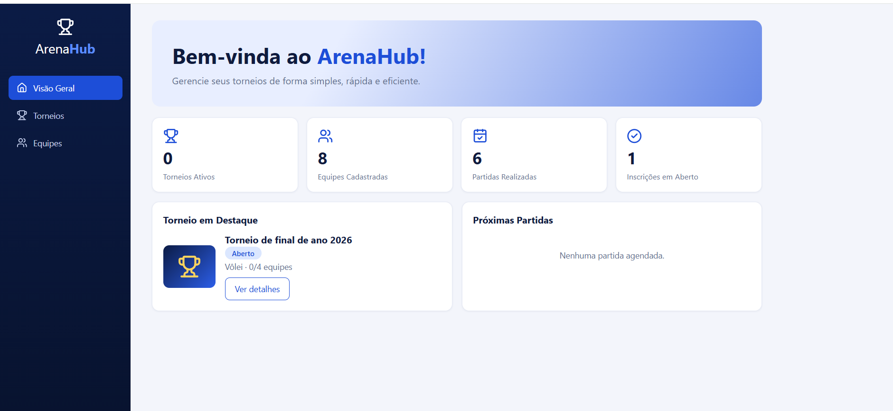
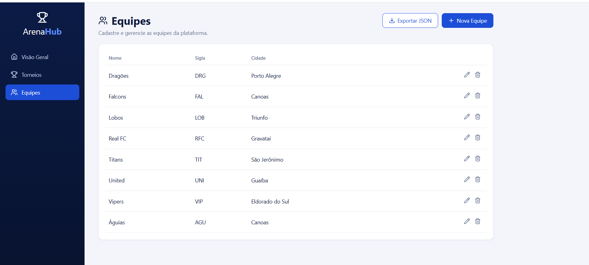
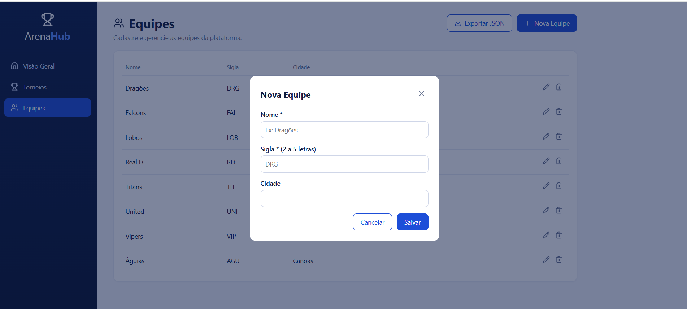
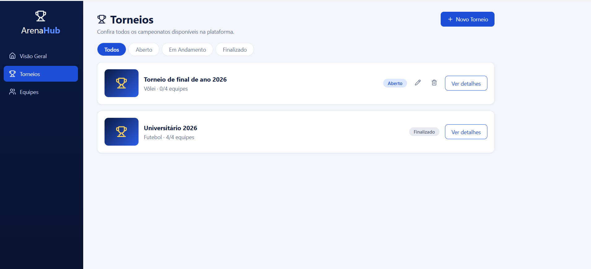
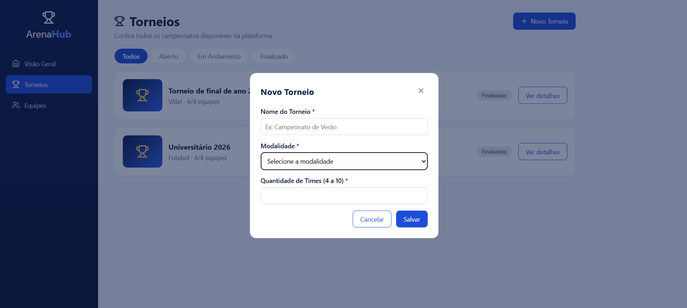
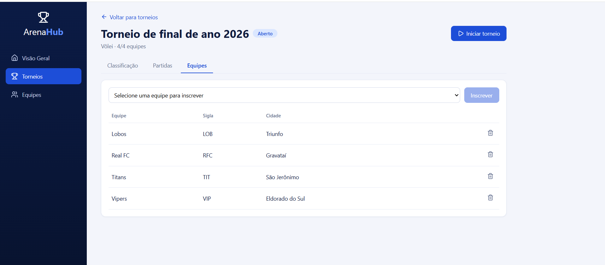
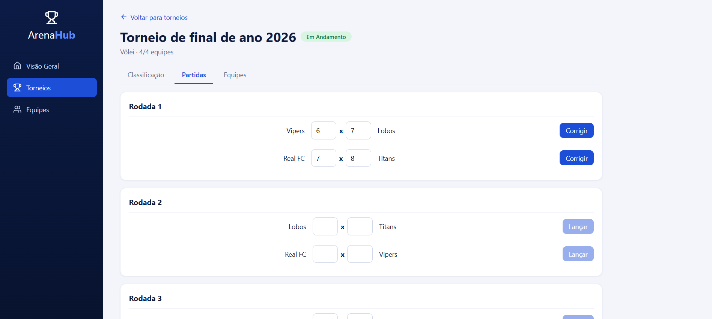
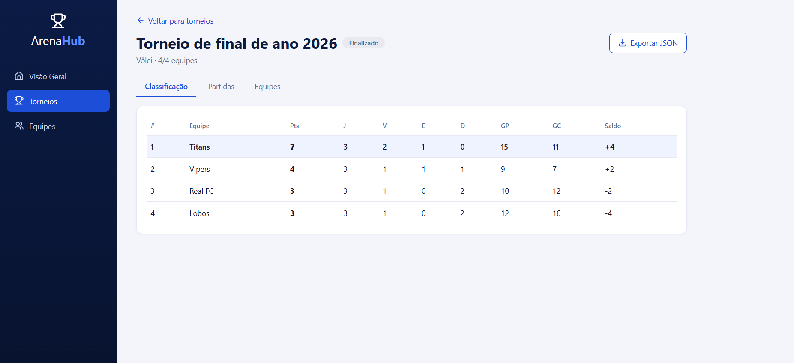
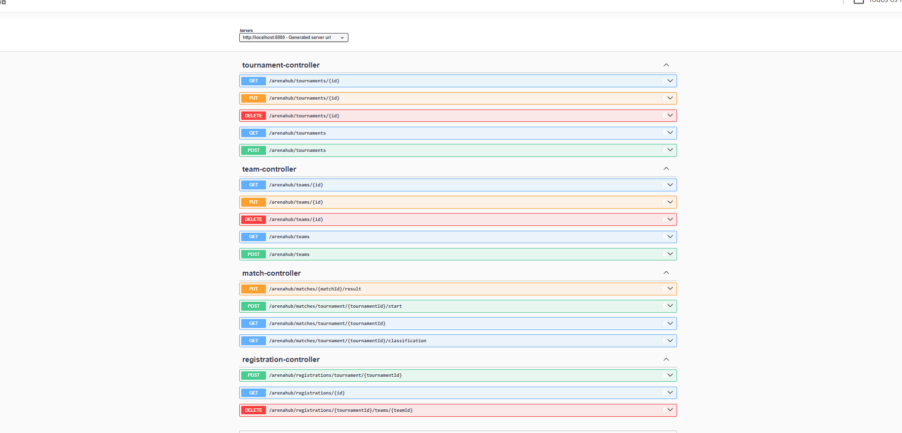

# ArenaHub

**Gestão de campeonatos em pontos corridos: do cadastro das equipes à classificação final.**



---

## 📖 Visão geral

O **ArenaHub** é uma aplicação web para organizar torneios esportivos no formato pontos corridos (todos contra todos, turno único). Ele substitui planilhas e anotações em papel: o organizador cadastra as equipes, cria o torneio, abre as inscrições, inicia a competição e o sistema gera a tabela de jogos automaticamente, recebe os placares e calcula a classificação em tempo real. Ao final, os dados podem ser exportados em JSON.

### O problema que resolve

A gestão manual de campeonatos é trabalhosa e sujeita a erros: cálculo da tabela, definição dos confrontos, equilíbrio dos mandos de campo e controle das inscrições. O ArenaHub automatiza esses processos.

---

##  Funcionalidades

- **Gestão de equipes:** CRUD completo (nome e sigla únicos).
- **Gestão de torneios:** CRUD com modalidade, limite de equipes (4 a 10) e controle de status (Aberto → Em Andamento → Finalizado).
- **Inscrições:** vínculo entre torneio e equipe, com validação de limite, duplicidade e status do torneio.
- **Geração automática de partidas:** algoritmo round-robin (método do círculo) com mandos de campo alternados.
- **Lançamento e correção de resultados:** o torneio é finalizado automaticamente quando a última partida termina.
- **Classificação dinâmica:** calculada na hora, com critérios de desempate.
- **Exportação em JSON:** download do torneio completo (participantes, classificação e partidas) e da lista de equipes.
- **Documentação interativa da API** com Swagger UI.
- **Tratamento padronizado de erros** em português, exibido na interface.

---

## Algumas telas da aplicação

### Tela inicial do dashboard


### Tela de visualização de equipes cadastradas


### Tela de cadastro de nova equipe


### Tela de visão geral de torneios


### Tela de cadastro de novo torneio


### Tela de visualização de equipes cadastradas no torneio


### Tela de lançamento de pontos no enfrentamento das equipes no torneio


### Tela de visualização final da tabela de classificação no torneio


### Documentação da API (Swagger UI)


---

## Tecnologias

| Camada | Tecnologia |
|---|---|
| Linguagem | Java 21 |
| Framework | Spring Boot 4.1 (Spring Web MVC) |
| Persistência | Spring Data JPA + Hibernate |
| Banco de dados | H2 (arquivo local) |
| Validação | Bean Validation |
| Documentação da API | springdoc-openapi 3.1 (Swagger UI) |
| Utilitários | Lombok |
| Build | Maven (Maven Wrapper incluso) |
| Front-end | React + Vite, React Router, Lucide Icons, CSS |

---

## 🔗 Relacionamentos

- **Torneio ⟷ Equipe (N:N):** resolvido pela entidade associativa **Registration** (inscrição). Existe uma restrição de unicidade no par `(torneio, equipe)`.
- **Torneio → Partida (1:N):** cada partida pertence a um único torneio.
- **Equipe → Partida (N:1, duas vezes):** cada partida tem uma equipe mandante e uma visitante.
- **A classificação não é uma entidade:** é calculada a partir das partidas finalizadas.

---

##  Arquitetura

O back-end é organizado em camadas, e as entidades nunca são expostas diretamente: toda entrada e saída usa **DTOs** (`record`).

```
backend/src/main/java/com/gabrielli/backend
├── controller   # recebe as requisições HTTP e devolve DTOs (sem regra de negócio)
├── service      # regras de negócio, algoritmo de partidas e classificação
├── repository   # interfaces Spring Data JPA
├── entity       # entidades JPA
├── enums        # Modality, TournamentStatus, MatchStatus, RegistrationStatus
├── dto          # records de entrada e saída
├── mapper       # conversão entidade ⇄ DTO
├── exception    # exceções próprias e tratador global (GlobalExceptionHandler)
└── config       # configuração de CORS
```

---

##  Regras de negócio

### Equipes
- Nome e sigla não podem se repetir.
- Não é possível excluir uma equipe que tenha inscrições ou partidas.

### Torneios
- O limite de equipes deve estar entre **4 e 10**.
- Só é possível editar ou excluir torneios com inscrições abertas.
- O limite não pode ser reduzido abaixo do número de equipes já inscritas.

### Inscrições
- Só é possível inscrever ou remover equipes com o torneio aberto.
- Não ultrapassa o limite de equipes e não permite inscrição duplicada.

### Início do torneio
- São necessárias no mínimo **4 equipes** inscritas.
- Ao iniciar, o status vira *Em Andamento* e todas as partidas são geradas.
- Um torneio não pode ser iniciado duas vezes.

### Resultados
- Só é possível lançar placar em torneios *Em Andamento*; placares não podem ser negativos.
- O resultado pode ser corrigido enquanto o torneio estiver em andamento.
- Quando a última partida é finalizada, o torneio passa a *Finalizado* automaticamente.

---

## Classificação

- Vitória = **3 pontos**, empate = **1 ponto**, derrota = **0**.
- Critérios de ordenação: **pontos → vitórias → saldo de gols → gols pró → nome**.
- Equipes inscritas sem jogos aparecem zeradas na tabela.

---

##  Como executar

### Pré-requisitos
- **Java 21** (JDK)
- **Node.js 20.19+** (ou 22.12+) com npm
- Não é necessário instalar Maven nem banco de dados (o projeto usa o Maven Wrapper e o H2)

### 1. Clonar o repositório
```bash
git clone https://github.com/Gabrielli-B/arenahub.git
cd arenahub
```

### 2. Back-end
```bash
cd backend
./mvnw spring-boot:run          # Linux / macOS
mvnw.cmd spring-boot:run        # Windows
```

A API sobe em **http://localhost:8080**.

| Recurso | URL |
|---|---|
| Swagger UI | http://localhost:8080/swagger-ui/index.html |
| Console do H2 | http://localhost:8080/h2-console |

### 3. Front-end

Em outro terminal:

```bash
cd frontend
npm install
npm run dev
```

A interface abre em **http://localhost:5173**.

Se o back-end estiver em outro endereço, crie um arquivo `frontend/.env` com:

```
VITE_API_URL=http://localhost:8080/arenahub
```

---

## 🗄️ Banco de dados

O projeto usa o **H2 em modo arquivo**, então os dados persistem entre execuções e não há nada para instalar.

| Configuração | Valor |
|---|---|
| JDBC URL | `jdbc:h2:file:./data/arenahubdb` |
| Usuário | `sa` |
| Senha | *(vazia)* |

> Banco local de desenvolvimento, sem credenciais reais. Os arquivos ficam em `backend/data/` e estão no `.gitignore`.

---

